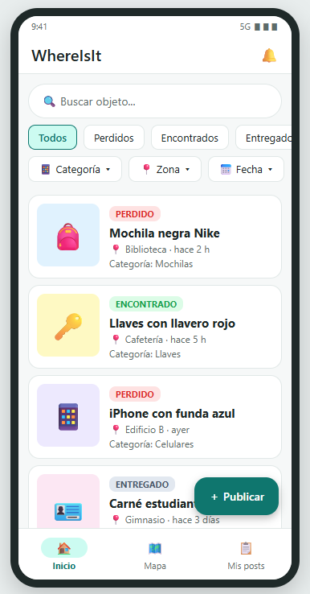
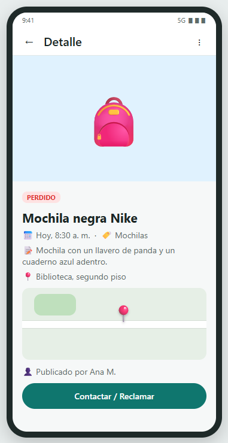
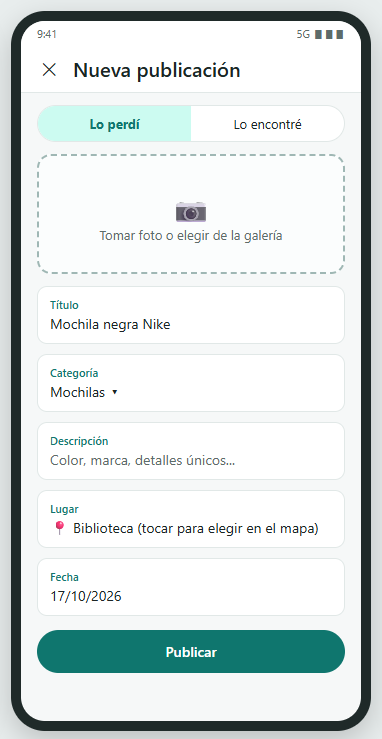
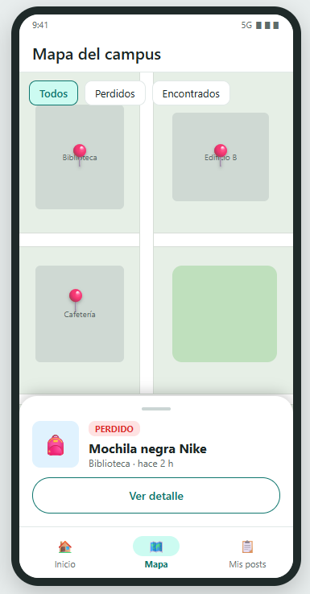
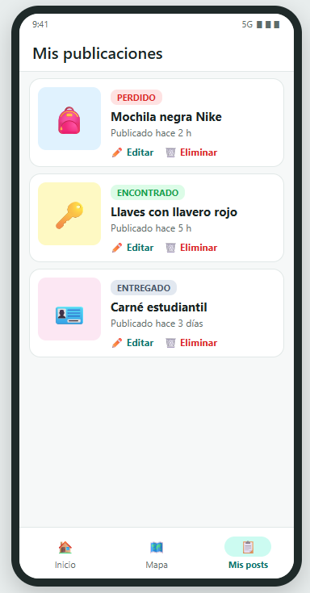
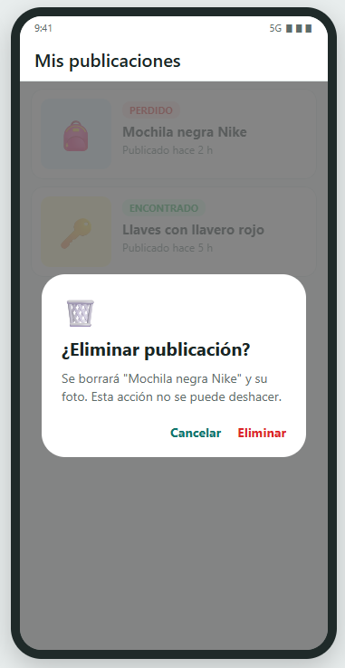
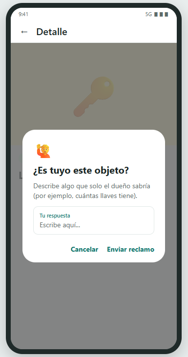
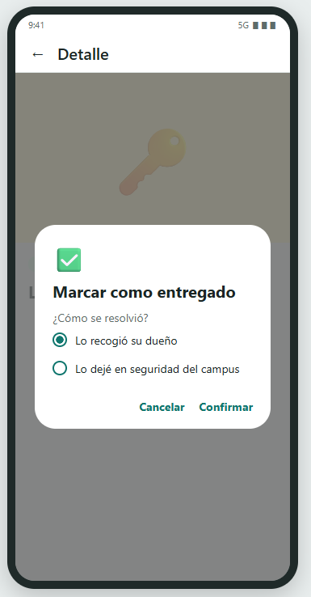
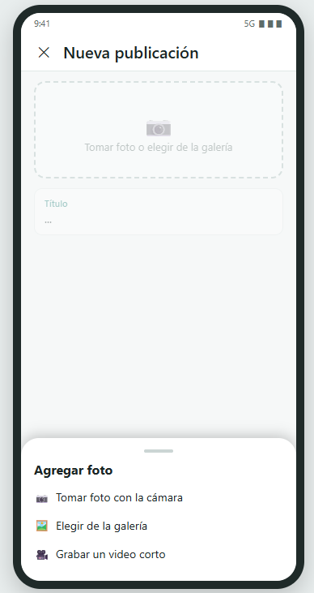

# WhereIsIt

- [ ]

## Descripción

WhereIsIt permite a los estudiantes publicar, buscar y reclamar objetos perdidos o encontrados dentro de la universidad. Cada publicación incluye una foto del objeto y su ubicación en un mapa, y la lista se puede filtrar por categoría, estado, zona y fecha para ayudar a que cada objeto regrese a su dueño.

## Integrante

- **Francisco Quirós Alvarado**

## Tecnologías

- Lenguaje: Kotlin
- IDE: Android Studio
- Mapa: Google Maps SDK (por definir)
- Almacenamiento de datos: Base de datos (por definir)

## Funcionalidades

| Requisito del curso              | Cómo se cubre en WhereIsIt                                                     |
| -------------------------------- | ------------------------------------------------------------------------------ |
| CRUD                             | Crear, ver, editar y eliminar publicaciones de objetos perdidos o encontrados  |
| Lista con filtros personalizados | Filtros por estado, categoría, zona del campus y fecha, más búsqueda por texto |
| Cámara o galería                 | Foto del objeto al publicar, tomada con la cámara o elegida de la galería      |
| Dialog                           | Confirmar eliminación, reclamar un objeto y marcar como entregado              |
| Mapa                             | Selección del lugar al publicar y pantalla con marcadores de todos los objetos |

## Mockups

Los mockups siguen las guías de Material Design para Android.

### 1. Inicio: lista con filtros

### 2. Detalle del objeto

### 3. Crear / editar publicación

### 4. Mapa con marcadores

### 5. Mis publicaciones

### 6. Dialog: confirmar eliminación

### 7. Dialog: reclamar objeto

### 8. Dialog: marcar como entregado

### 9. Selector de cámara o galería

## Buenas prácticas de UX aplicadas

- Navegación inferior con los tres destinos principales: Inicio, Mapa y Mis publicaciones.
- Botón flotante "Publicar" siempre visible para la acción principal.
- Estados identificados con color y texto (perdido, encontrado, entregado), sin depender solo del color.
- Confirmación mediante dialog en las acciones destructivas.
- Filtros visibles como chips, fáciles de activar con el pulgar.
- Formulario corto con selector "Lo perdí / Lo encontré" y lugar elegido directamente en el mapa.

## Posibles mejoras futuras

- Inicio de sesión con correo institucional
- Notificaciones cuando se publique un objeto parecido al que perdiste
- Chat entre quien encontró el objeto y quien lo perdió
- Soporte para varias sedes o universidades
- Mostrar la ubicación actual del usuario.
